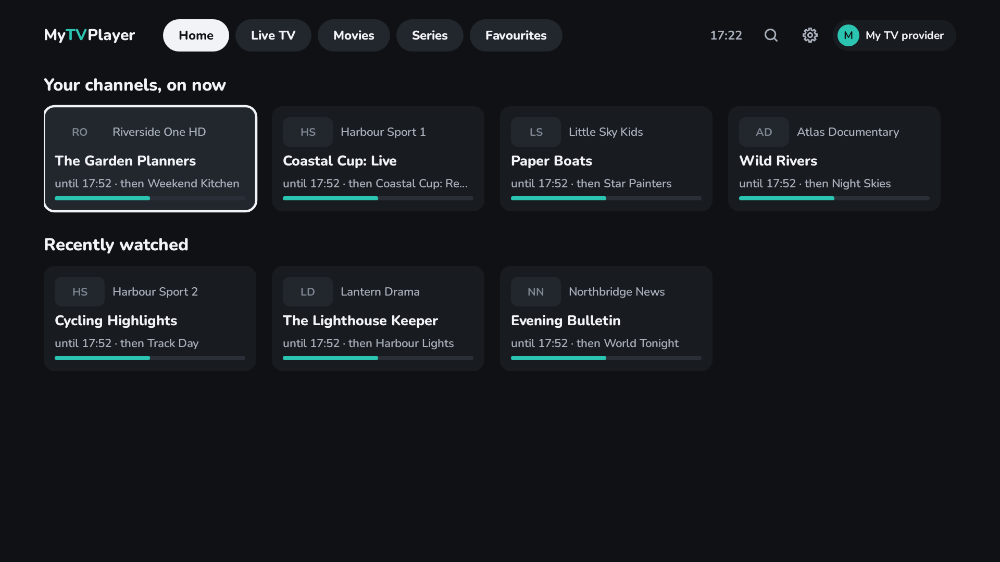
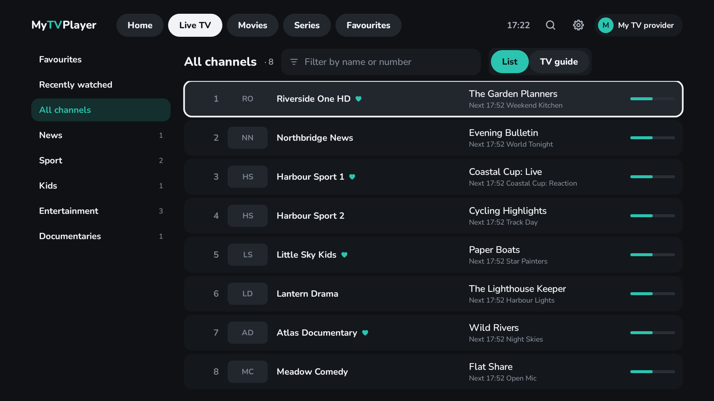
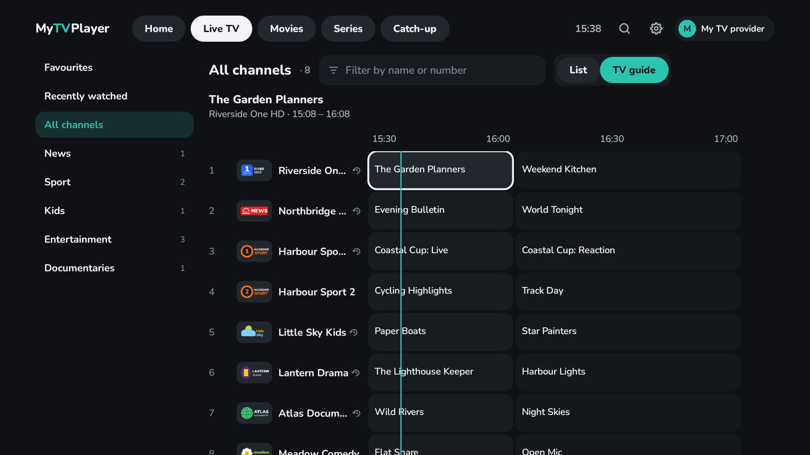
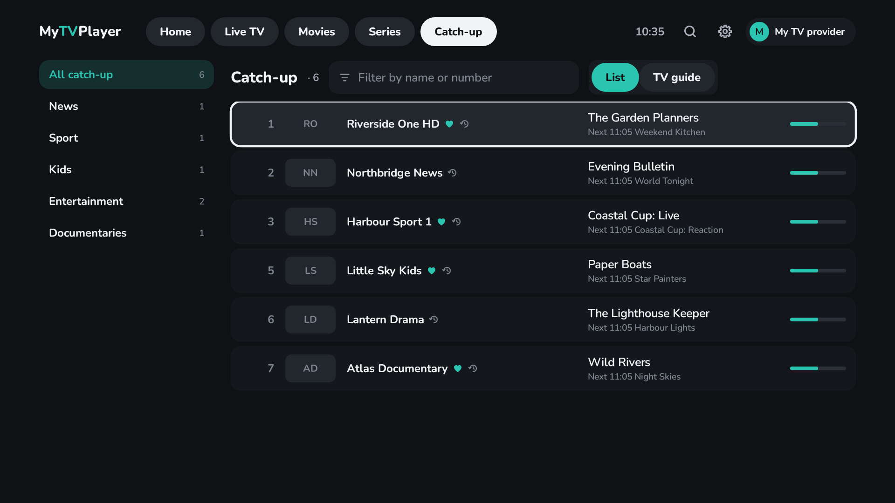
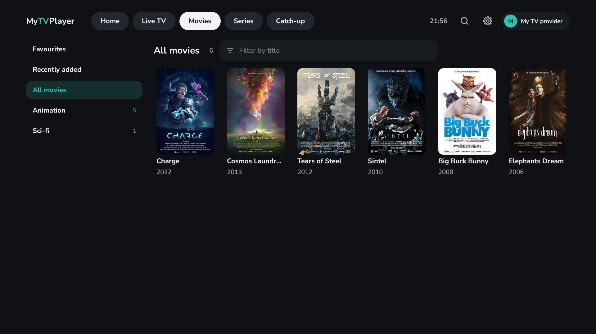
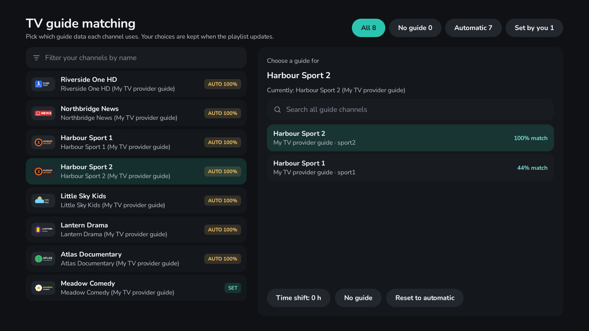
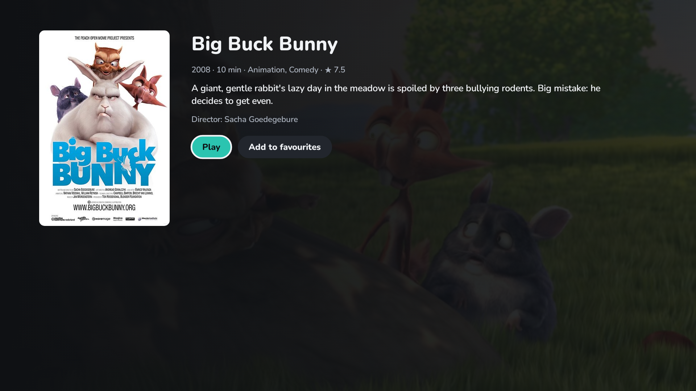
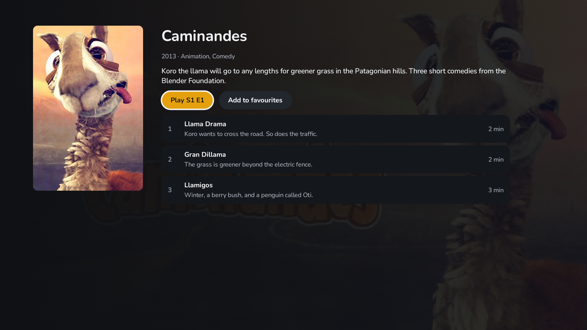

[](https://ko-fi.com/biskyt) [](https://github.com/sponsors/biskyt)

_This work is free, with no ads and no tracking. If you find it useful, you can support its development by buying me a coffee with the links above._


# MyTVPlayer

A fast, free and open-source IPTV player for Android TV and Fire TV (Android 9 and later). It's built to feel quick
on low-powered TV boxes and sticks, and to make it easy to find something to watch and press play.

- **Fast**, even on budget boxes, with channel lists of thousands.
- **Excellent TV guide matching**, with simple manual overrides when you want them.
- **Small**: an 8 MB download.
- **No ads, no tracking, no accounts.** Every feature is free.
- **Your own provider or free channels**: add your IPTV provider's Xtream Codes login or M3U playlist, or start
  straight away with the free [iptv-org](https://github.com/iptv-org/iptv) channels, which are built in.
- **Movies, series and catch-up TV**, for providers that offer them.



| | |
|---|---|
|  |  |
|  |  |

<sub>Demo channels and logos are invented. Movies and series: the Blender Foundation's open movies, CC BY 3.0/4.0,
cropped ([credits, with each image's author and licence](app/src/test/resources/demo-art/CREDITS.md)).</sub>

## Features

### Live TV and the TV guide
- **Channel list** with logos and what's on now and next, or a **full TV guide grid**: switch between them with one
  press.
- **Categories grouped by country and language** (from names like `UK |` or `FR:`). Pick the ones you want and only
  those are downloaded, so even very large playlists stay quick. Hide any category you don't need.
- **Filter by name or number**, or type a channel number on the remote to jump straight to it.
- **Home** shows your favourite channels with what's on now, recently watched channels and what you're part-way
  through.
- **Search** everything at once: channels, what's on TV now and later, movies and series.
- The remote's **Guide** button opens the TV guide from anywhere.

### TV guide matching


- Channels are matched to their guide automatically, including tricky names: misspellings, "HD/FHD" tags, US call
  signs and state names.
- Add your provider's guide, free guides for 75 countries ([iptv-epg.org](https://iptv-epg.org)) or any XMLTV
  address.
- **Manual overrides**: for any channel, pick its guide from ranked suggestions or search every guide channel, and
  set a time shift. Your choices are kept when the playlist updates.
- **Match channels without a guide** finds guides for the channels that still have none.

### Catch-up TV
- A **Catch-up** tab lists those channels by category; a small ⟲ mark shows them everywhere else too.
- Browse the last few days, day by day, or scroll back in the TV guide and pick a finished programme.
- **Start over** watches what's on now from its beginning.
- Works with Xtream Codes accounts, and with M3U playlists that declare catch-up on their channels (`catchup`,
  `catchup-days`, `catchup-source`). M3U catch-up is offered in hour-long slots.

### Movies and series
| | |
|---|---|
|  |  |

- From Xtream Codes accounts, or from an M3U playlist's own movies and series playlists (one playlist holding both is
  fine: episodes like "Show S01E02" go to Series, the rest to Movies).
- Browse by category with posters, filter by title, and see what's recently added.
- Details pages with plot, cast and running time (where the provider gives them), and every season and episode of a
  series.
- Movies and episodes **resume where you left off**, the next episode starts on its own, and **Carry on watching**
  on Home takes you straight back.
- From a programme in the TV guide, **Find series** or **Find in Movies** to watch it on demand.

### Playback
- Now and next, and the controls, on OK. The channel's guide opens in a side panel without stopping the picture.
- Skip back and forward (10 s / 30 s by default), or hold ◀ ▶ to scrub along the play bar.
- **Audio passthrough** of Dolby, DTS and Atmos to your soundbar or TV, with a software fallback.
- **Subtitles**: forced subtitles in your TV's language by default, or always available, or off.
- When something won't play, a clear message says why.

### And more
- **Several playlists**: add as many as you like and switch between them from the top bar. Settings shows when a
  provider's subscription expires.
- **Backup and restore** of your playlists, choices, favourites, guide matching and progress, to a file you can
  copy to another TV.
- **Appearance**: preset accent colours and large text.
- **Looks after its own storage**: only the guide for channels you use is kept, logos are capped and the database is
  kept compact.

What's planned is in [ROADMAP.md](ROADMAP.md); what's changed in each version is in [CHANGELOG.md](CHANGELOG.md).

## Install on your TV (sideload)

1. Download `MyTVPlayer-<version>.apk` from the latest [release](../../releases) (or a CI run's `MyTVPlayer-apk`).
2. Copy the APK to the TV (e.g. with the *Downloader* or *Send Files to TV* app, or a USB stick) and open it with a
   file manager; allow installs from that app when asked.

Development builds are signed with a shared public test key (`app/debug.keystore`) so they install over each other.
Releases are signed with a private key held in the repository's secrets; see [RELEASING.md](RELEASING.md).

## Build

Requires JDK 17+ and the Android SDK (platform 36).

```sh
./gradlew assembleRelease          # app/build/outputs/apk/release/app-release.apk
./gradlew :core:test testDebugUnitTest   # unit, Robolectric and UI tests
./gradlew ktlintCheck detekt lintDebug   # style and static checks
./gradlew recordRoborazziDebug     # refresh the test screenshots in app/screenshots
./gradlew :app:recordRoborazziDebug --tests '*StoreAssetsTest*' -PstoreAssets   # store/ (README and store listings)
```

Project layout: `core/` is plain Kotlin (Xtream client, XMLTV parser, guide matching, player key logic) with fast JVM
tests; `app/` is the Android TV app (Jetpack Compose for TV, Room, Media3 ExoPlayer).

## Support

MyTVPlayer is free, with no ads and no tracking. If you find it useful, you can support its development:

- [Ko-fi](https://ko-fi.com/biskyt)
- [GitHub Sponsors](https://github.com/sponsors/biskyt)

## Licence

GPL-3.0 (see `LICENSE`). Nunito font: SIL Open Font License. Playback uses AndroidX Media3 and FFmpeg (LGPL).
