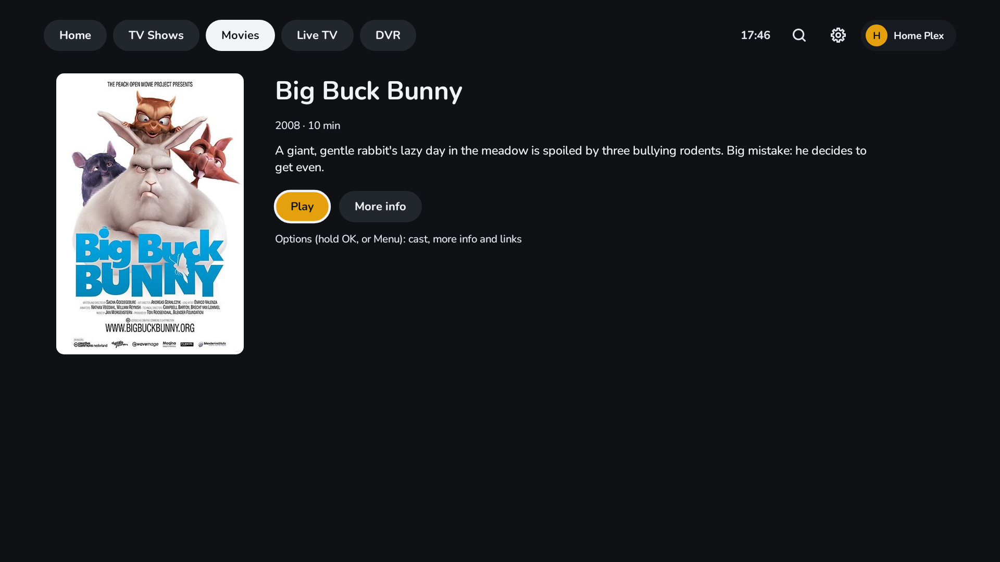
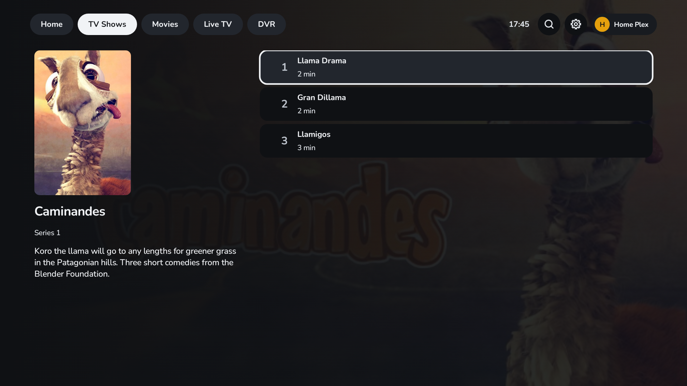
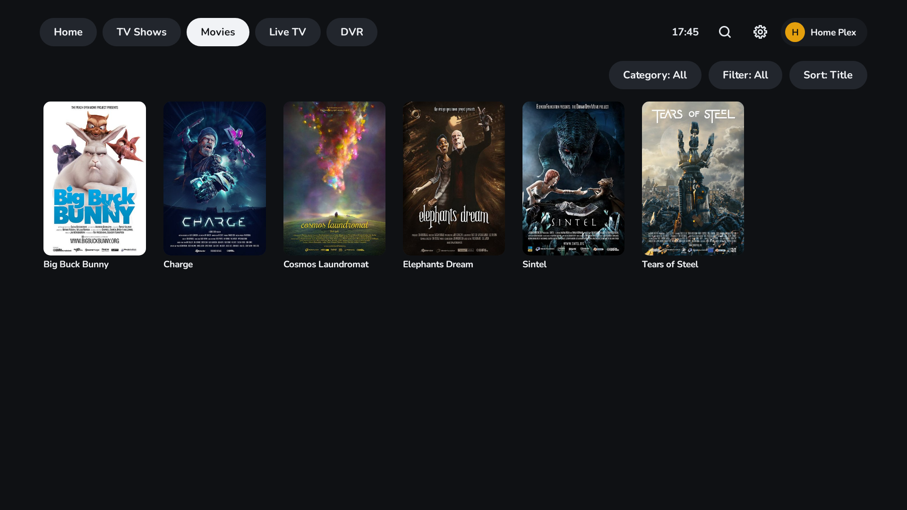
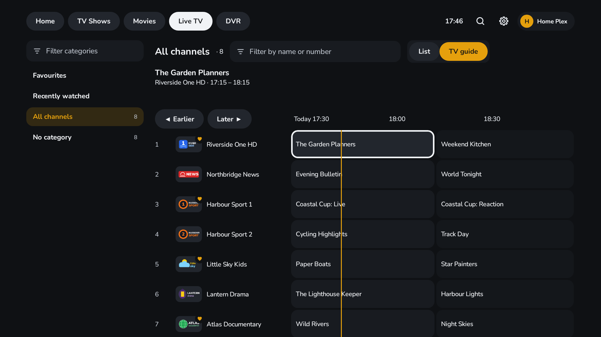

[](https://ko-fi.com/biskyt) [](https://github.com/sponsors/biskyt)

_This work is free, with no ads, no tracking and no data collection. If you find it useful, you can support its development by buying me a coffee with the links above._


# MyPlexPlayer

A fast, lightweight and free player for your own **Plex Media Server**, made for Android TV, Google TV and Fire TV
(Android 9 and later). It also works by touch on phones and tablets.


MyPlexPlayer is an independent app. It is not made or endorsed by Plex, Inc. You need your own Plex Media Server.

## Why MyPlexPlayer
- **Fast and lightweight:** a small app that starts quickly and stays smooth on older TV boxes.
- **Free, with no ads and no tracking:** no analytics, no advertising and no account of its own. Open source (GPL-3.0).
- **Never transcodes:** it plays your files as they are, so a low-powered server is enough. When the TV can't open a
  file's container, the server only repackages it, with the picture and sound copied.
- **Made for the remote:** every screen works with the D-pad, the Guide button, channel up and down, and number keys.

## Features
- **Sign in with a code:** enter the code shown on the TV at plex.tv/link. Every server on your account is ready to use.
- **Home:** Continue watching, recently added series and films, your favourites, and your favourite channels with
  what's on now.
- **Films and TV shows** from your Plex libraries, with filters, sorting, and pages that show the cast, scores and the
  picture and sound of each title.
- **Picks up where you left off:** what you watch, and how far you got, is saved on your Plex server, the same as in
  your other Plex apps.
- **Skip intro and credits**, by itself after a short countdown or when you press the button.
- **4K, HDR10, HDR10+ and Dolby Vision**, with Dolby Atmos and other surround sound sent to your soundbar or receiver.
- **Subtitles and audio tracks:** forced subtitles in your language by default, and every track to choose from.
- **Live TV and the TV guide** from your Plex server's tuner, 8 days ahead. Your favourite channels are your Plex
  favourites.
- **DVR:** record a programme or a whole series from the TV guide, and see what's recording, what's coming up and your
  series recordings.
- **Search** across films, series, channels and programmes.
- **Languages:** English, Spanish, Portuguese (Brazil) and French.

| | |
|---|---|
|  |  |
|  |  |

## Install
- **Google Play:** search for MyPlexPlayer on your Android TV or Google TV.
- **Amazon Appstore:** search for MyPlexPlayer on your Fire TV.
- **Sideload:** download `MyPlexPlayer-<version>.apk` from the latest [release](../../releases), copy it to the TV
  (for example with the *Downloader* or *Send Files to TV* app) and open it with a file manager.

A store install and a sideloaded APK are signed with different keys, so one can't update the other. Use one of them on
each device.

## Build

Requires JDK 17 or later and the Android SDK (platform 36).

```sh
./gradlew assembleRelease                 # app/build/outputs/apk/release/app-release.apk
./gradlew :core:test testDebugUnitTest    # unit, Robolectric and UI tests
./gradlew ktlintCheck detekt lintDebug    # style and static checks
./gradlew :app:recordRoborazziDebug --tests '*StoreAssetsTest*' -PstoreAssets   # store/ (README and store listings)
```

Project layout: `core/` is plain Kotlin (the Plex client, parsers and the player's key logic) with fast JVM tests.
`app/` is the Android app (Jetpack Compose for TV, Room, Media3 ExoPlayer). Releases and signing:
[RELEASING.md](RELEASING.md). Store listings: [store/README.md](store/README.md).

## Support

MyPlexPlayer is free, with no ads and no tracking. If you find it useful, you can support its development:

- [Ko-fi](https://ko-fi.com/biskyt)
- [GitHub Sponsors](https://github.com/sponsors/biskyt)

## Licence

GPL-3.0 (see `LICENSE`). Nunito font: SIL Open Font License. Playback uses AndroidX Media3 and FFmpeg (LGPL). The demo
art in the screenshots is from the Blender Foundation's open movies (CC BY), see
[the credits](app/src/test/resources/demo-art/CREDITS.md).
