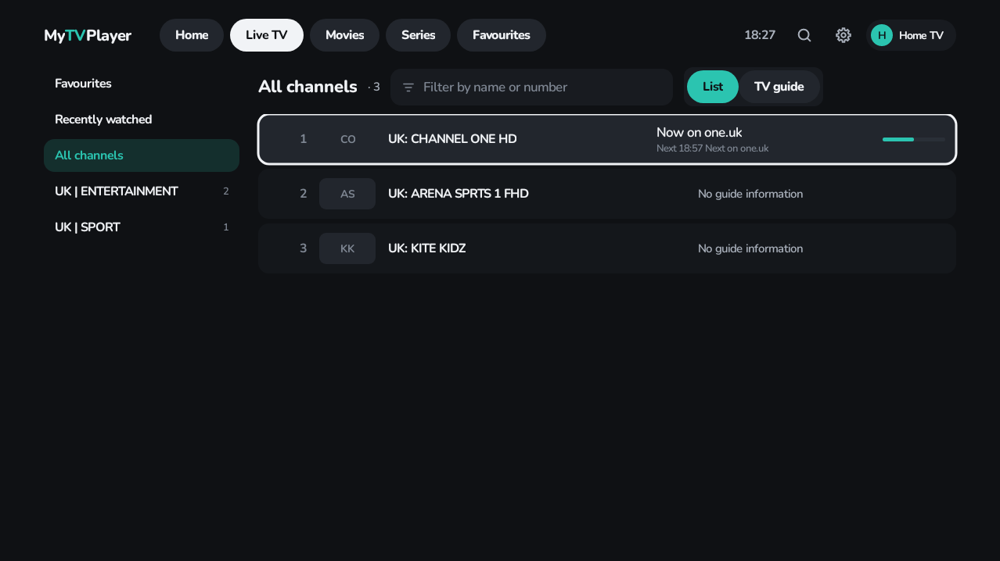

# MyTVPlayer

A free, open-source IPTV player for Android TV (Android 11+), built for low-powered TV boxes and for people who
just want to find their programmes and press play. No ads, no tracking, every feature free. GPL-3.0.



## What it does (first release)

- **Xtream Codes playlists**: add as many as you like, edit login details any time, switch from the top bar.
- **Languages & categories**: categories are grouped by language/country (detected from names like `UK |`, `FR:`);
  only the ones you tick are downloaded, so huge provider lists stay fast.
- **Live TV list** with logos and now/next, a category column, filter by name or number, and number keys to jump to a
  channel. Moving through the list never changes channel; OK plays.
- **Full TV guide grid** (List | TV guide switch).
- **TV guide matching**: add extra XMLTV guides and choose, per channel, which guide channel it uses (with suggestions
  for misspelt provider names and a time shift). Your choices survive playlist updates. Hold OK on any channel →
  *Change guide source…*.
- **Player**: now/next and controls on OK, channel guide in a side panel without stopping the picture, ◀ ▶ skip
  (configurable, default 10 s / 30 s), ▲ ▼ change channel, Back stops.
- **Audio passthrough** on by default (Dolby / DTS / Atmos to your soundbar or TV), FFmpeg audio fallback when off.
- **Subtitles**: forced-only in the TV's language by default; off / always available.
- **Appearance**: any accent colour (default mint), large text.
- **Storage managed automatically**: only programmes for channels you use are kept (3 days), channel logos are capped
  at 30 MB, and the database is compacted when needed.

Coming next: movies & series with posters and resume, global search, catch-up, reminders, backup & restore
(see [ROADMAP.md](ROADMAP.md)).

## Install on your TV (sideload)

1. Download `MyTVPlayer-<version>.apk` from the latest [release](../../releases) (or a CI run's `MyTVPlayer-apk`).
2. Copy the APK to the TV (e.g. with the *Downloader* or *Send Files to TV* app, or a USB stick) and open it with a
   file manager; allow installs from that app when asked.

Development builds are signed with a shared public test key (`app/debug.keystore`) so they install over each other.
Releases are signed with a private key held in the repository's secrets; see [RELEASING.md](RELEASING.md).

## Build

Requires JDK 17+ and the Android SDK (platform 36).

```sh
./gradlew assembleRelease          # app/build/outputs/apk/release/app-release.apk
./gradlew :core:test testDebugUnitTest   # unit, Robolectric and UI tests
./gradlew ktlintCheck detekt lintDebug   # style and static checks
./gradlew recordRoborazziDebug     # refresh the screenshots in app/screenshots
```

Project layout: `core/` is plain Kotlin (Xtream client, XMLTV parser, guide matching, player key logic) with fast JVM
tests; `app/` is the Android TV app (Jetpack Compose for TV, Room, Media3 ExoPlayer).

## Licence

GPL-3.0 (see `LICENSE`). Nunito font: SIL Open Font License. Playback uses AndroidX Media3 and FFmpeg (LGPL).
